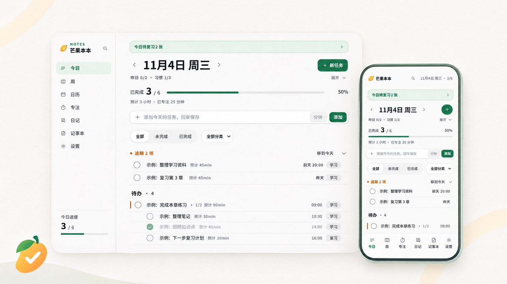
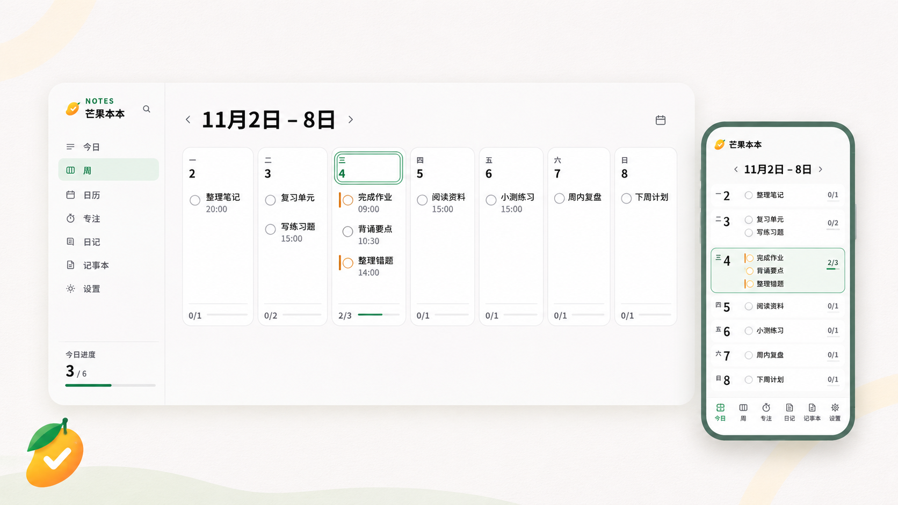
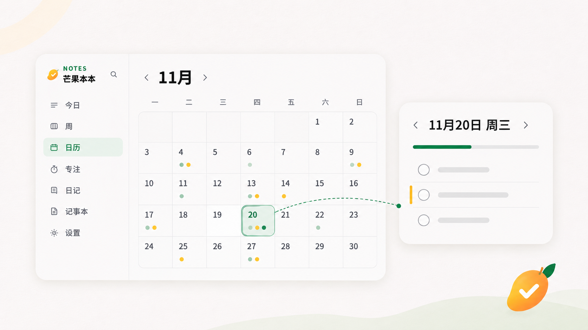
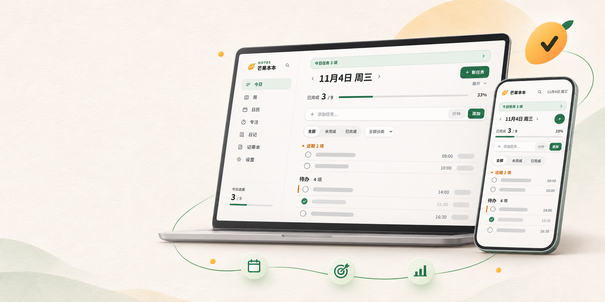
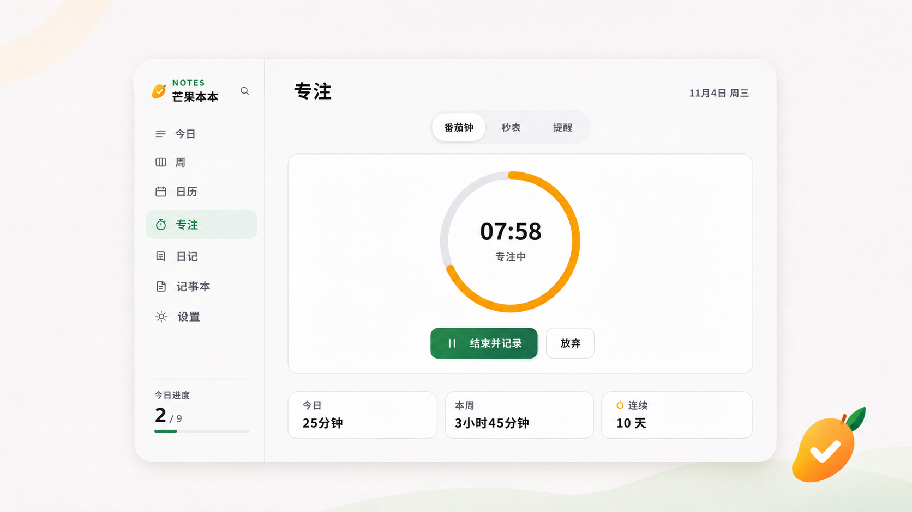
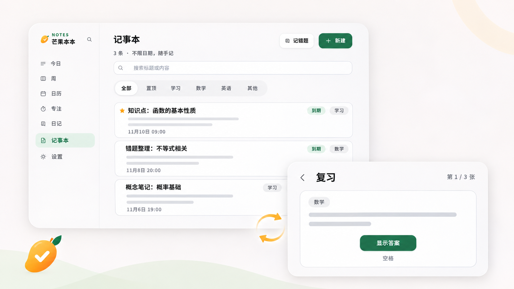
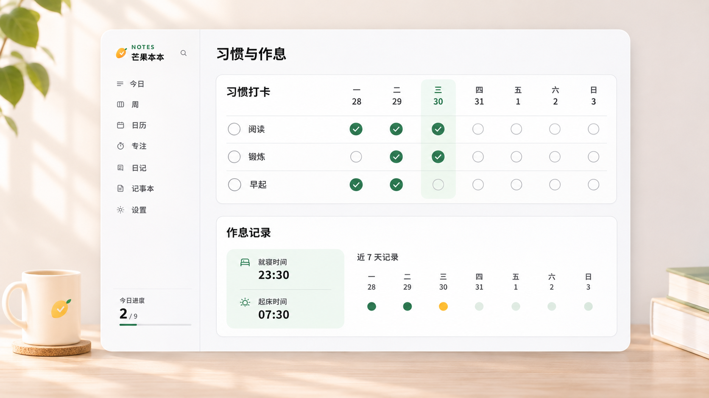
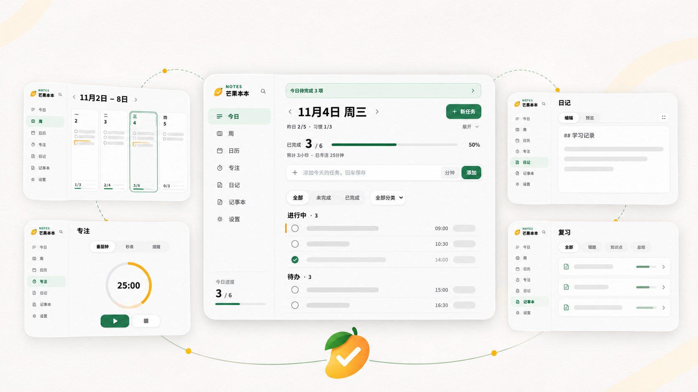

# 芒果本本（Mango Notebook）


**把计划、专注、复习和复盘放进同一条学习流程。** 芒果本本是一款离线优先的个人学习规划应用：你可以安排每天与每周的任务，用专注计时记录投入，把笔记和错题加入间隔复习，再通过日记、习惯和作息记录回看自己的节奏。

**Mango Notebook** is an offline-first personal learning planner for daily tasks, weekly planning, focus sessions, spaced-repetition notes, journaling, habits, and routines.

[](LICENSE)

> **图片说明：** 下方功能图是为项目介绍制作的生成式产品示意图，不是从当前运行版本截取的实机截图。图中的文字、日期和界面细节仅作视觉展示；具体功能以本仓库源码和实际运行版本为准。

## 你可以用它做什么

- **安排任务：** 建立今日待办、按分类组织任务、查看完成进度，并用周计划和日历安排后续。
- **记录专注：** 使用番茄钟或秒表工作，把完成的专注时段汇总到任务和每日统计中。
- **复习学习内容：** 整理笔记与错题，按标签查找，并通过间隔重复队列安排回顾。
- **留下学习记录：** 用 Markdown 写日记、生成周度回顾，同时跟踪习惯和起床/睡觉作息。
- **掌握自己的数据：** 官方 Windows 与 Android 版本默认本地保存；可以通过数据导入、导出和备份迁移。

## 功能一览

### 今日任务：把当天要做的事变成清晰清单

在今日页查看当天安排、任务完成情况与进度；任务可以按日期和分类组织。逾期事项、预计用时和已专注时间等信息帮助你判断今天的负担。若有到期复习卡片，今日页也会给出复习入口。



### 周计划与日历：从一周到某一天安排进度

周计划适合先排出一周的学习骨架，再逐日调整；日历则用于按月或按周浏览任务，并切到某一天查看安排。设置中还可以配置每周模板和一周从哪天开始。

| 周计划 | 月历与当日任务 |
| --- | --- |
|  |  |

### 专注计时：用番茄钟或秒表记录投入

按任务开始一段专注，选择番茄钟或秒表，并查看今天与本周的专注情况。番茄时长、每日目标、严格模式和自动续接等选项可在设置中调整；提醒与计入统计的专注记录分开处理。

| 专注与规划 | 番茄钟与计时 |
| --- | --- |
|  |  |

### 笔记与间隔复习：从记录走到回顾

把学习笔记、错题或待记内容保存在笔记区，用标签整理。进入复习后先尝试回忆答案，再对掌握程度进行评价；复习进度据此安排后续回顾。你也可以查看待复习数量，并在设置中管理每日新卡上限。



### 习惯与作息：留下每天的轻量记录

配置需要坚持的习惯，在今日页完成打卡，并通过打卡日历回看记录；也可以登记起床和睡觉时间，观察作息变化。



### 日记与周回顾：记录过程，也总结进展

日记支持 Markdown 编辑和预览。周回顾可汇总任务与专注等数据，并写入对应日期的日记，方便将计划、执行情况和个人想法放在一起查看。

Markdown 链接支持 HTTP(S) 与 mailto。Windows 桌面版点击外链后会交给系统默认浏览器打开；网页版会在新标签页打开。链接使用 `noreferrer`，不会把应用页面地址作为来源传给目标站点。外部站点仍会按浏览器正常请求获得访问所需的信息；应用没有内置网页浏览或网页抓取界面。日记图片支持本地内嵌 PNG/JPEG/WebP；当前内容安全策略不允许加载远程图片。


### 一套流程，多处衔接

任务、专注、复习、习惯与日记在应用内相互连接：从今天的任务开始，记录投入，回顾学习内容，再留下复盘。



### Web、Windows 与 Android

项目包含 Web、Windows 桌面与 Android 客户端。三端共享主要应用逻辑，并由各自的平台壳提供运行能力。下面的多屏图是概念展示，不能代替真实设备截图或兼容性测试。


## 平台、登录与数据

| 版本 | 登录与数据方式 |
| --- | --- |
| 网页版 | 已部署版本可访问，保留项目方登录与云端同步；使用手机号短信验证码登录。 |
| Windows | 默认开源版本不提供项目方账号登录，数据保存在本机。 |
| Android | 默认开源版本不提供项目方账号登录，数据保存在本机。 |

Windows 和 Android 默认版本适合不依赖项目方账号、本地管理学习数据的使用方式。源码保留自有服务器接入路径：用户可以填写自己的服务配置并自行构建客户端。**目前服务器地址在构建时配置；已安装客户端没有运行时更换服务器的设置页。** 自建服务还需要自行实现账号认证、用户数据隔离和备份策略。

数据导入导出、桌面自动备份以及自有服务的配置方式见 [`docs/SELF-HOSTING.md`](docs/SELF-HOSTING.md)。请勿将个人 `.env.local`、服务密钥、Android 签名文件或真实用户数据提交到公开仓库。

## 开始使用

### 在浏览器中开发

需要 Node.js 与 npm。在项目根目录运行：

```bash
npm ci
npm run dev
```

### 开发与构建命令

```bash
# 常用质量检查与 Web 构建
npm test
npm run typecheck
npm run build
npm run web:build

# Windows 桌面端
npm run desktop:dev
npm run desktop:exe
npm run desktop:build

# Android
npm run android:sync
```

以上是项目提供的命令，不代表每种系统环境和构建产物都已在本次发布中逐一验证。自有服务器客户端的环境变量与构建步骤请先阅读 [`docs/SELF-HOSTING.md`](docs/SELF-HOSTING.md)。

## 技术栈

React、TypeScript、Vite、Electron 与 Capacitor。Web、Windows 和 Android 共用 `src/` 中的应用逻辑，平台能力由 Electron 和 Capacitor 提供。

## 许可证

本项目以 Apache License 2.0 开源，详见 [`LICENSE`](LICENSE)。
